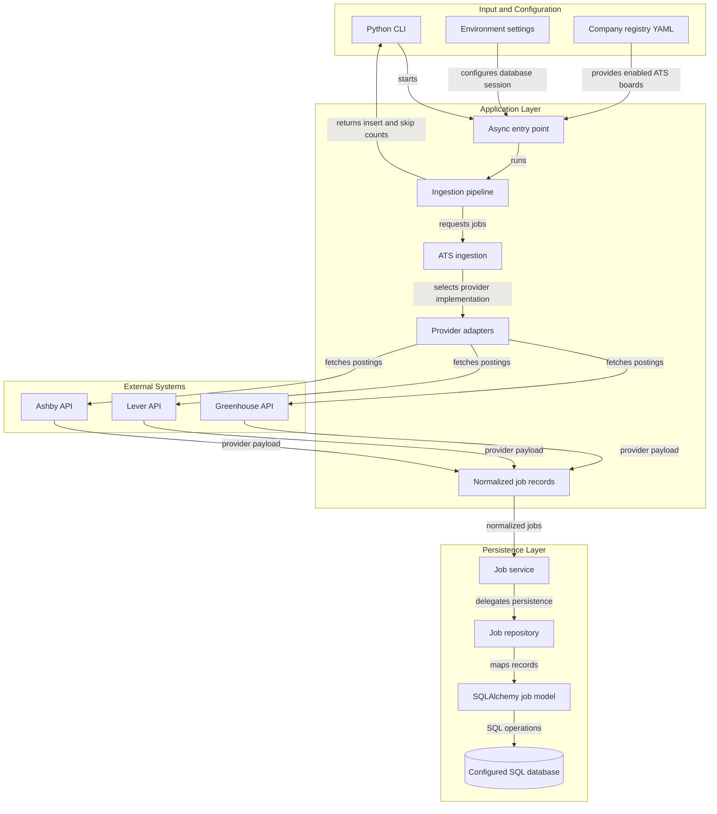
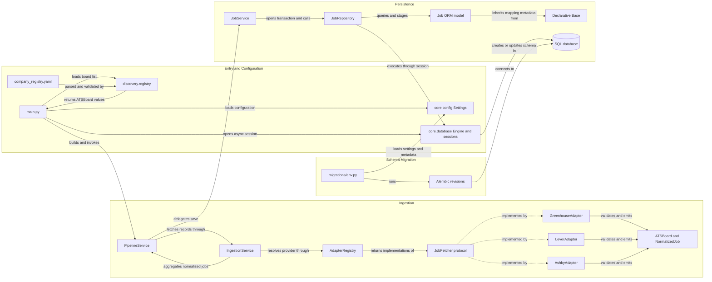
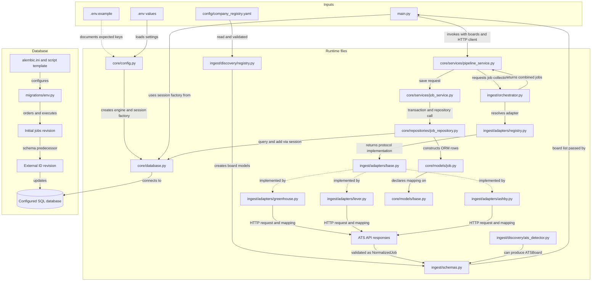

# Architecture Diagram

JobHunter currently runs as a Python command-line batch ingestor. It reads configured ATS boards, fetches postings from provider APIs, normalizes them, and persists unique jobs through an asynchronous SQLAlchemy pipeline.

## Application Architecture

<!-- mermaid-checked: no \n, no em-dash/en-dash, no {} in labels, subgraphs are id["label"], arrows are -->|"label"|, all subgraphs closed by end, ids unique -->

### Technology Stack Summary

| Layer | Technology | Version | Purpose |
|---|---|---|---|
| Runtime | Python | 3.11 or newer | Runs the async command-line ingestion job |
| HTTP | httpx | `>=0.28.1` | Calls provider posting APIs |
| Validation | Pydantic | `>=2.14.2` | Validates board and normalized-job records |
| Configuration | pydantic-settings, PyYAML | `>=2.16.2`, `>=6.0.3` | Reads environment settings and company registry |
| Persistence | SQLAlchemy asyncio | `>=2.1.6` | ORM mapping, sessions, and transactions |
| Database drivers | aiosqlite, psycopg | `>=0.22.1`, `>=3.3.7` | Support configured database backends; deployed backend is URL-dependent |
| Schema migrations | Alembic | `>=1.20.1` | Applies database schema revisions |
| Tests and lint | pytest, pytest-asyncio, Ruff | `>=9.2.0`, `>=1.4.1.post1`, `>=0.17.3` | Test suite and linting |

### Data Storage & External Services

Job records are stored in the database selected by `DATABASE_CONNECTION_STRING`; the project includes SQLite async and PostgreSQL driver dependencies but does not declare one fixed deployment database. The batch process reads public job-board endpoints from Greenhouse, Lever, and Ashby using a shared async HTTP client. Telegram and Gemini credentials are loadable settings but are not used in the current ingestion path.

### Key Architectural Decisions

- Provider-specific adapters implement a common `JobFetcher` protocol and emit the shared `NormalizedJob` schema.
- Persistence is layered through `PipelineService`, `JobService`, and `JobRepository`; `JobService` owns the SQLAlchemy transaction boundary.
- Duplicate identity is the `(source, external_id)` pair, checked in batches and also protected by a database unique constraint.
- Duplicate pre-checks do not lock rows; concurrent writers are ultimately guarded by the unique constraint and can still receive a database integrity error.

## Component Relationships

<!-- mermaid-checked: no \n, no em-dash/en-dash, no {} in labels, subgraphs are id["label"], arrows are -->|"label"|, all subgraphs closed by end, ids unique -->

### Component Inventory

| Component | Layer | Type | Responsibility |
|---|---|---|---|
| `main.py` | Entry | CLI and composition root | Loads boards, creates HTTP and DB sessions, runs pipeline, prints result |
| `Settings` | Configuration | Pydantic settings | Reads environment and `.env` values and builds the database URL |
| `AsyncSessionLocal` | Persistence | Session factory | Creates async SQLAlchemy sessions using the configured engine |
| `load_company_registry` | Discovery | YAML loader and validator | Validates board configuration, rejects duplicates, omits disabled entries |
| `ATSBoard` | Ingestion contract | Pydantic model | Identifies provider, board ID, company, and optional career URL |
| `NormalizedJob` | Ingestion contract | Pydantic model | Defines the common job record passed to persistence |
| `IngestionService` | Ingestion | Orchestrator | Fetches jobs for boards in registry order and combines results |
| `AdapterRegistry` | Ingestion | Factory-like registry | Selects the adapter matching each provider |
| `JobFetcher` | Ingestion | Protocol | Declares the adapter fetch interface |
| Provider adapters | Integration | HTTP clients and mappers | Call ATS APIs, check HTTP status, map response data to `NormalizedJob` |
| `PipelineService` | Application | Coordinator | Coordinates fetch and persistence and logs stage counts |
| `JobService` | Application | Service | Wraps repository writes in a session transaction |
| `JobRepository` | Data access | Repository | Checks existing keys, removes in-batch duplicates, stages new ORM rows |
| `Job` and `Base` | Data model | SQLAlchemy ORM | Map job fields and table constraints |
| Alembic environment and revisions | Database operations | Migration runner and schema history | Builds the migration engine and applies schema changes |
| `detect_ats_board` | Discovery utility | URL parser | Extracts supported provider and board ID from a career URL; not currently called by `main.py` |

## File-Level Data Flow

This view traces the runtime path through the concrete files. The URL detector is shown as a separate optional helper because the current CLI gets board IDs from YAML instead of calling it.

<!-- mermaid-checked: no \n, no em-dash/en-dash, no {} in labels, subgraphs are id["label"], arrows are -->|"label"|, all subgraphs closed by end, ids unique -->

### File-by-File Responsibility and Data

#### Runtime and configuration files

| File | Data or control handled |
|---|---|
| `main.py` | Application entry point; loads configured boards, creates shared `httpx.AsyncClient` and DB session, invokes the pipeline, reports `SaveResult`. |
| `core/__init__.py` | Package marker; no runtime data transformation. |
| `core/config.py` | Reads database and optional Telegram/Gemini values; URL-encodes the optional DB password placeholder and exposes `database_url`. |
| `core/database.py` | Creates the async engine and session factory from `Settings.database_url`. |
| `core/models/__init__.py` | Package marker; no runtime data transformation. |
| `core/models/base.py` | Declares the SQLAlchemy `DeclarativeBase` used by ORM models and migrations. |
| `core/models/job.py` | Maps normalized job attributes to `jobs` columns and declares unique `(source, external_id)` identity. |
| `core/repositories/__init__.py` | Package marker; no runtime data transformation. |
| `core/repositories/job_repository.py` | `save_job()` checks and stages one record; `save_jobs()` checks existing keys in batches of 400, suppresses DB and same-batch duplicates, creates and stages rows, and returns inserted/skipped counts. |
| `core/services/__init__.py` | Package marker; no runtime data transformation. |
| `core/services/job_service.py` | Opens `session.begin()`, calls repository `save_jobs`, and returns its result after transaction completion. |
| `core/services/pipeline_service.py` | Fetches normalized jobs through ingestion, delegates persistence, logs counts, and returns `SaveResult`. |
| `ingest/__init__.py` | Package marker; no runtime data transformation. |
| `ingest/schemas.py` | Defines validated `ATSBoard` and `NormalizedJob` data contracts; sets `discovered_at` in UTC by default. |
| `ingest/orchestrator.py` | Iterates through boards, chooses provider adapters, and aggregates each board's normalized jobs. |
| `ingest/adapters/__init__.py` | Package marker; no runtime data transformation. |
| `ingest/adapters/base.py` | Defines the async `JobFetcher.fetch_jobs` protocol used by adapters. |
| `ingest/adapters/registry.py` | Builds the Greenhouse, Lever, and Ashby adapters and resolves one by provider name. |
| `ingest/adapters/greenhouse.py` | Calls the Greenhouse board endpoint and maps job ID, title, location, content, URL, and publication time. |
| `ingest/adapters/lever.py` | Calls the Lever postings endpoint and maps ID, text, location, description, apply URL, and millisecond timestamp. |
| `ingest/adapters/ashby.py` | Calls the Ashby job-board endpoint and maps ID or job URL, title, location, description, apply URL, and publication time. |
| `ingest/discovery/__init__.py` | Package marker; no runtime data transformation. |
| `ingest/discovery/registry.py` | Loads and validates YAML board entries, rejects duplicate provider/board pairs, filters disabled entries, returns `ATSBoard` objects. |
| `ingest/discovery/ats_detector.py` | Parses supported ATS career URLs into `ATSBoard`; present as a utility but not wired into the current CLI flow. |

#### Configuration and migration files

| File | Data or control handled |
|---|---|
| `config/company_registry.yaml` | Current three enabled board records: Greenhouse, Lever, and Ashby. |
| `.env.example` | Lists expected database, Telegram, and Gemini environment variable names without values. |
| `pyproject.toml` | Declares Python requirement, runtime and development dependencies, pytest settings, and Ruff rules. |
| `alembic.ini` | Points Alembic at `migrations/` and configures migration logging; `migrations/env.py` replaces the URL from settings. |
| `migrations/env.py` | Loads model metadata and app database URL, then executes online async or offline migrations. |
| `migrations/versions/356773060425_create_jobs_table.py` | Creates or drops the initial `jobs` table. |
| `migrations/versions/d9210ce4f052_added_external_id_and_unique_identifier_.py` | Adds required `external_id`, makes `source` required, and creates the unique provider/external-ID constraint. |
| `migrations/script.py.mako` | Alembic template for generating future revision files. |
| `migrations/README` | Alembic migration directory note; no runtime data handling. |
| `README.md` | Project landing page; currently contains only the project title. |

#### Test files

Tests use in-memory SQLite for most persistence checks and mocked HTTP responses for provider integrations; they do not participate in production data flow.

| File | Coverage focus |
|---|---|
| `tests/__init__.py` | Test package marker. |
| `tests/unit/test_ashby.py` | Ashby response mapping and HTTP success, error, and empty-board cases. |
| `tests/unit/test_greenhouse.py` | Greenhouse response mapping and HTTP success, error, and empty-board cases. |
| `tests/unit/test_lever.py` | Lever response mapping and HTTP success, error, and empty-board cases. |
| `tests/unit/test_ats_detector.py` | ATS URL detection and malformed or unsupported URL handling. |
| `tests/unit/test_company_registry.py` | Registry loading, disabled records, duplicates, validation, and YAML parsing failures. |
| `tests/unit/test_adapter_registry.py` | Provider-to-adapter lookup. |
| `tests/unit/test_orchestrator.py` | Multi-board aggregation, empty boards, and unsupported provider handling. |
| `tests/integration/test_database.py` | Basic configured database connectivity. |
| `tests/integration/test_job_repository.py` | Repository insert, deduplication, and bounded duplicate-query batching. |
| `tests/integration/test_job_service.py` | Service transaction commit and rollback behavior. |
| `tests/integration/test_pipeline_service.py` | Pipeline success, empty results, rollback, and end-to-end configured registry ingestion. |
| `tests/integration/test_jobs.py` | Job record creation and retrieval. |
| `tests/integration/test_savejob.py` | Single-job persistence and duplicate handling. |

## Low-Level Design

### Runtime flow

1. `main()` configures logging and starts `run_ingestion()` with `AsyncSessionLocal`.
2. `run_ingestion()` loads the enabled board list from the YAML registry. Pydantic rejects invalid provider values and malformed required fields; the loader also rejects duplicate provider/board pairs.
3. One async HTTP client and one async DB session are opened for the run. The composition root creates `AdapterRegistry`, `IngestionService`, `JobService`, and `PipelineService`.
4. `PipelineService` calls `IngestionService.ingest()`. The orchestrator processes boards sequentially, gets an adapter using `board.provider`, and passes that board and shared HTTP client to its adapter.
5. Each adapter checks its provider, makes a provider-specific GET request with a 20-second timeout, raises on non-success HTTP status, parses the response shape, and constructs `NormalizedJob` instances. The common schema requires `external_id`, `title`, `company`, and `source`; other posting fields are optional.
6. `JobService.save_jobs()` starts a transaction and delegates to `JobRepository.save_jobs()`. The repository deduplicates keys in the input, queries existing keys in chunks of 400, ignores persisted and repeated input keys, maps remaining jobs to ORM objects, and adds them to the session. Exiting the transaction commits; an exception triggers transaction rollback.
7. `SaveResult(inserted, skipped)` returns to the pipeline and CLI. Inserted counts staged new rows and skipped counts duplicates detected by the repository.

### Persistence model

| Table | Columns and constraints |
|---|---|
| `jobs` | `id` integer primary key; required `title`, `company`, `source`, `external_id`; optional `location`, `description`, `apply_url`, `posted_at`; required `discovered_at`. |
| Uniqueness | Unique constraint `uq_job_source_external_id` on `(source, external_id)`. |
| Timestamps | `posted_at` is optional and sourced from the ATS. `discovered_at` defaults to the current UTC time when constructing a normalized job. |

The ORM model is the migration metadata source. The migration history first creates the table and then adds the external identifier and uniqueness constraint. Alembic obtains its database URL from application settings in `migrations/env.py`; the CLI does not apply migrations automatically, so schema migration is a separate operation.

### Interfaces and error behavior

| Boundary | Input | Output or failure behavior |
|---|---|---|
| Company registry | YAML file path, defaults to `config/company_registry.yaml` | List of enabled `ATSBoard` values; YAML syntax errors become `ValueError`, Pydantic validation errors and duplicate-board errors are raised. |
| Adapter fetch | `ATSBoard`, shared `httpx.AsyncClient` | List of `NormalizedJob`; unsupported provider at registry lookup, board/provider mismatch, HTTP errors, malformed provider payloads, and validation errors propagate. |
| Repository save | List of `NormalizedJob` and injected `AsyncSession` | `SaveResult`; database errors propagate to the transaction boundary. |
| CLI run | Configured session factory | Prints completion counts on success; no app-level recovery or retry layer is present in the current flow. |

The runtime does not currently have a web/API layer, notification integration, job search/read service, retry policy, or ATS auto-discovery step connected to the CLI. Telegram and Gemini settings and `detect_ats_board()` exist, but are not used by the ingestion pipeline at this point.
